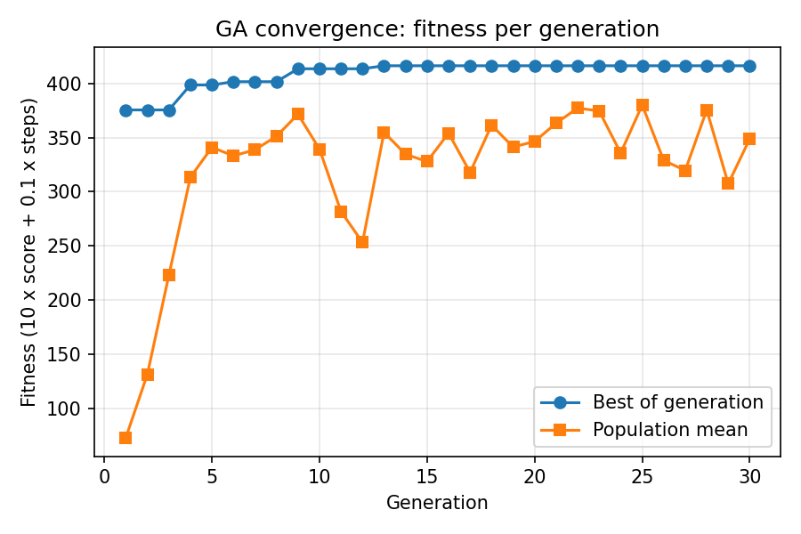
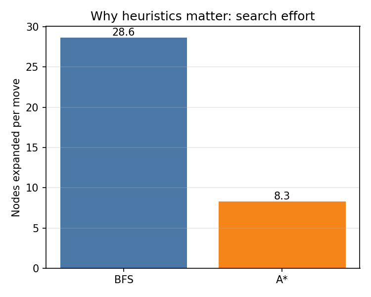
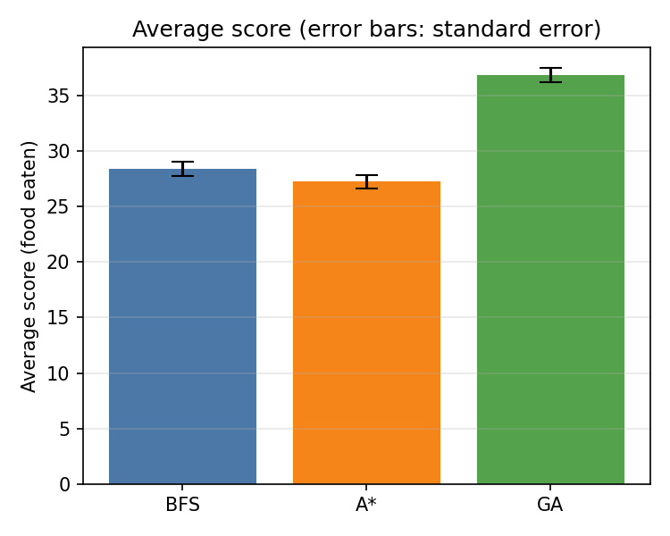
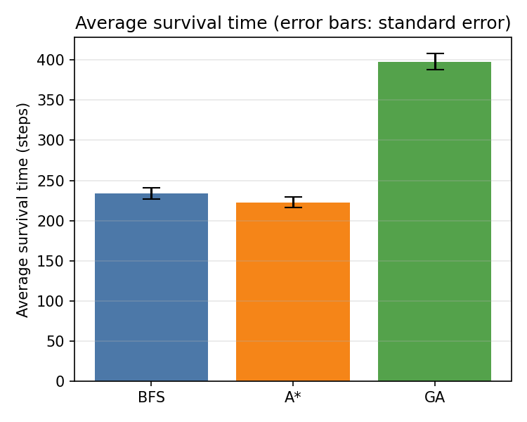
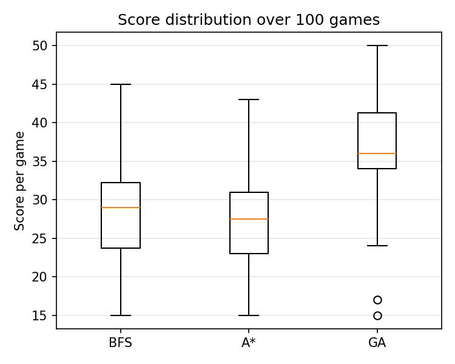
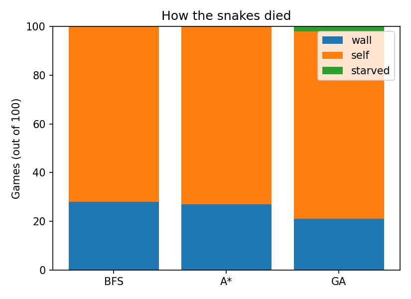

**AL-2002 Artificial Intelligence (Lab), Fall 2026, FAST-NUCES Karachi**

Group: *[Member 1 name, roll no.]* and *[Member 2 name, roll no.]*. Repository: *[GitHub link]*

## 1. Introduction

This project compares three ways of playing the classic game of Snake on a 10x10 board:

- a **BFS snake** that finds food with breadth-first search,
- an **A\* snake** that finds food with A* search and a Manhattan-distance heuristic,
- a **GA snake** that scores each possible move with a weighted rule whose four weights are evolved by a genetic algorithm.

The questions are simple. Does a heuristic help? What goes wrong for a snake that only chases food? Can evolution find a safer strategy? All three snakes play the **same 100 games** and are compared on score, survival time and (for the search snakes) search effort. Everything is written in Python with NumPy; Matplotlib draws the charts and Pygame gives an optional window.

**Summary of findings.** A* and BFS find paths of the same length, but A* expands about **71% fewer nodes** per move (8.3 against 28.6). Their scores are not meaningfully different (27.2 against 28.4). Both search snakes die only when they are trapped by their own body. The evolved GA snake scores **36.8** on average and survives **398 moves** against about 230 for the search snakes, because it learned to value open space.

## 2. Problem formulation

### 2.1 State, actions, transition, goal

| Element | Definition |
|---|---|
| State | Board size, the snake's cells from head to tail, the food cell, score, moves since the last food. |
| Actions | UP, DOWN, LEFT, RIGHT. |
| Transition | The head moves one cell. If it lands on food the snake grows and new food appears on a random free cell; otherwise the tail follows. |
| Terminal | Head leaves the board ("wall"), head hits the body ("self"), 100 moves without eating ("starved"), 5000 moves ("timeout"), or the board is full ("won"). |
| Goal (for search) | The head reaches the food cell. Every move costs 1, so path cost = number of moves. |

### 2.2 PEAS

| | |
|---|---|
| Performance measure | Score (food eaten) and survival time (moves before dying). |
| Environment | 10x10 grid with walls, the snake's body and one piece of food. |
| Actuators | One of four moves each turn. |
| Sensors | The full board: head, body and food positions. |

### 2.3 Environment classification

| Property | Value | Why |
|---|---|---|
| Observable | Fully | The agent sees the whole board. |
| Deterministic | Yes (movement) | A move always has the same effect. The only random part is where new food appears, and it comes from a seeded generator. |
| Static | Yes | The game waits for the agent to choose. |
| Discrete | Yes | Grid cells, four actions, whole time steps. |
| Agents | Single | No opponent. |
| Episodic or sequential | Sequential | A move now changes which moves are safe later. |

### 2.4 Agent types

The BFS and A* snakes are **goal-based agents**: they plan a sequence of actions that reaches a goal, then take the first action and plan again. The GA snake is a **utility-based agent**: it gives every action a number (its utility) and takes the highest. In the code the three share the base class `Agent`, which declares `choose_move(game)`.

## 3. Design

| Class (file) | Role | OOP idea |
|---|---|---|
| `Snake` (`game.py`) | The body: a deque of cells plus a set for fast lookup. | Encapsulation: the body is private (`_body`) and only `move()` changes it; `cells` returns a copy. |
| `SnakeGame` (`game.py`) | The environment: rules, food, scoring, death. Has its own seeded `random.Random`. | Encapsulation: `step()` is the only transition. |
| `Agent` (`agents.py`) | Base class with `choose_move()` and `reset()`. | Inheritance: parent of all agents. |
| `PathAgent(Agent)` | Plans a path to the food and takes its first step. | Overrides `choose_move()`; declares `find_path()` for children. |
| `BFSAgent(PathAgent)` | Uses `bfs`. | Overrides `find_path()`. |
| `AStarAgent(PathAgent)` | Uses `astar`. | Overrides `find_path()`. |
| `GAAgent(Agent)` | Scores each move with `weights . features`. | Overrides `choose_move()`. |

Other modules: `search.py` (BFS, A*), `ga.py` (genetic algorithm), `runner.py` (`play_game`), `experiment.py` (table and charts), `viewer.py` (Pygame), `main.py` (menu), `config.py` (every parameter in one place).

## 4. Implementation of each technique

### 4.1 Breadth-first search (Lab 04): `search.bfs`

The **frontier** is a `collections.deque` used as a FIFO queue, so the closest cells are expanded first. The **explored** set holds expanded cells, and a `parent` dictionary remembers how each cell was reached; it also tells us which cells are already on the frontier, so nothing is added twice. When the goal is taken from the queue, the path is rebuilt by walking the parent links backwards. The function returns the path (a list of actions), its cost and the number of nodes expanded. Because all moves cost 1, BFS returns a shortest path.

The snake's body is treated as a fixed wall during the search (the tail cell is allowed because it moves away). This is a simplification: the body will actually move while the snake follows the path.

### 4.2 A* search (Lab 05): `search.astar`

A* expands the cell with the lowest **f = g + h**, where g is the cost so far and h is the heuristic. The frontier is a binary heap (`heapq`) of tuples `(f, h, counter, cell)`. Ties on f go to the smaller h (the cell nearer the food), and then to insertion order. A cell that was already expanded is skipped if it appears again (a stale heap entry).

**Heuristic.** h(n) is the **Manhattan distance** |dx| + |dy| from the cell to the food.

- *Admissible:* every move changes x or y by exactly 1, so at least |dx| + |dy| moves are needed. The heuristic never overestimates, even though the body may force a longer real path.
- *Consistent:* one move changes h by at most 1, which is the cost of the move, so the first time A* expands a cell it already has the cheapest cost to it.

Therefore A* returns the same optimal path length as BFS, and the comparison measures only effort.

### 4.3 The GA snake's decision rule: `agents.move_features`, `GAAgent`

For each of the four moves the agent computes four features:

| # | Feature | Meaning |
|---|---|---|
| 0 | safe | 1 if the move does not hit a wall or the body, else 0 (an unsafe move gets all zeros). |
| 1 | closer | +1 if the move gets closer to the food (Manhattan distance), -1 if further. |
| 2 | space | Cells reachable from the new cell (flood fill) divided by the board size. |
| 3 | exits | Safe neighbours of the new cell divided by 3. |

The score of a move is the dot product of the weights and its features, and the highest score wins (ties keep the first action). For example, with the evolved weights `[0.527, 0.101, 0.945, 0.256]`, a safe move that gets closer to the food, with 60% of the board reachable and 2 exits, scores 0.527 + 0.101 x 1 + 0.945 x 0.60 + 0.256 x 0.67 = 1.37.

### 4.4 The genetic algorithm (Lab 06): `ga.evolve`

An **individual** is a vector of four weights. The **fitness** of an individual is the average over the 5 training games of `10 x score + 0.1 x steps`: eating dominates, and surviving longer breaks ties.

| Parameter | Value | Role |
|---|---|---|
| Population size | 20 | Individuals per generation. |
| Generations | 30 | Number of rounds of evolution. |
| Initial weights | Uniform in [-1, 1] | Random start, seed 42. |
| Selection | Tournament of 3 | Parent = the fittest of 3 random individuals. |
| Crossover | Uniform | Each child weight comes from a random parent. |
| Mutation | Rate 0.3, Gaussian sigma 0.3 | Each weight changes with probability 0.3 by a small random amount. |
| Elitism | 2 | The two best are copied unchanged, so the best fitness never drops. |
| Training seeds | 1000 to 1004 | Kept apart from the test seeds 0 to 99. |

{width=60%}

The population mean rises steeply in the first five generations: most random weight vectors are poor, and selection quickly removes them. The best fitness is already high in generation 1 because with only four weights, 20 random vectors often contain a decent one, and it then improves in small steps (generations 4, 6, 9 and 13). After generation 13 no better individual was found within the 30 generations.

**Evolved weights:** safe = 0.527, closer = 0.101, **space = 0.945**, exits = 0.256. Space received the largest weight. Moving toward the food has the smallest weight, so the GA snake does not chase food as eagerly as the search snakes; it prefers moves that keep the most of the board reachable.

## 5. Experiments and results

### 5.1 Setup

- Each snake plays 100 games on seeds 0 to 99 (the same seeds for every snake, so each game starts from the same board and the same first food). Later food positions depend on where each snake has been.
- The GA weights come from training on seeds 1000 to 1004, so the test games are unseen.
- Run `python src/experiment.py` to reproduce everything. Training takes about 4 minutes.

### 5.2 Results table

| Agent | Avg score | Std score | Max score | Avg survival (steps) | Std survival | Avg nodes expanded / move |
|---|---|---|---|---|---|---|
| BFS | 28.37 | 6.52 | 45 | 234.2 | 70.8 | 28.6 |
| A* | 27.24 | 5.99 | 43 | 222.6 | 66.4 | 8.3 |
| GA | 36.82 | 6.16 | 50 | 398.0 | 99.0 | - |

Cause of death over 100 games: BFS: wall 28, self 72. A*: wall 27, self 73. GA: wall 21, self 77, starved 2.

The standard error of each average score is about 0.6, so the difference between BFS and A* (1.1 points, about 1.3 standard errors of the difference) is **not significant**, while the difference between the GA snake and BFS (8.5 points) is about 9 standard errors.

### 5.3 Why heuristics matter

{width=45%}

Both searches return shortest paths, so the paths are the same length. BFS expands cells in all directions, like a growing circle around the head, while A* is pulled toward the food by the heuristic. On this board that means about **71% fewer expansions** (8.3 against 28.6 per move). The heuristic saves *effort*, not *score*: the small score difference between BFS and A* is within noise, and comes from tie-breaking (when several shortest paths exist, the two algorithms pick different ones, and this changes the shape the body takes).

### 5.4 Score and survival time

{width=45%}

{width=45%}

{width=45%}

The GA snake wins on both measures: 36.8 against 27 to 28 in score, and 398 against 223 to 234 in survival time. The box plot shows that the whole distribution moves up, not only the average: the GA snake's median score (36) is higher than the 75th percentile of BFS (32.25) and A* (31). Even so, no snake comes close to filling the board (the maximum possible score is 97; the best single game was 50).

### 5.5 How the snakes die

{width=45%}

The labels "wall" and "self" say only which obstacle the snake's last, forced move hit. In this code the BFS and A* snakes **never step onto an unsafe cell while a safe one exists**: they follow a safe path, or if there is no path to the food they take any safe neighbour. So every BFS and A* death happens when **no safe move was left at all**, which is what "traps itself" means. The snake chases the nearest food by the shortest path, curls its growing body around itself, and eventually the head is boxed in.

The GA snake dies in the same way (its scores for safe moves are always positive, so it also prefers any safe move), but it is trapped later because its rule rewards moves that keep a large area reachable. Two GA games ended by starvation: the snake kept moving safely for 100 moves without reaching the food.

### 5.6 Discussion

1. **Heuristics matter for effort.** A* gave the same optimal paths with about a third of the node expansions. On a 10x10 board both are fast; we did not test other board sizes.
2. **Optimal paths are not a safe strategy.** Being optimal for the *next* food says nothing about the snake's future. Both search snakes fail the same way.
3. **Evolution found a safer rule.** The GA gave the highest weight to open space and the smallest to food direction. It did not need to be told that "chasing food traps you"; the fitness function (score and survival) was enough.
4. **Honest caveat.** The "space" feature (flood fill) was designed by us. The GA learned *how much to trust it*, not that it should exist. We did not test a GA without this feature, so we cannot say how much of the advantage comes from the feature and how much from the evolved weights.

## 6. Testing

`python -m unittest discover tests` runs 10 unit tests:

| Test | What it checks |
|---|---|
| Wall kills | Moving up repeatedly ends the game with cause "wall". |
| Unknown action | `step("JUMP")` raises `ValueError`. |
| Same seed | Two games with seed 7 place the first food identically. |
| BFS = A* cost | On 30 boards both searches return the same path cost, and A* never expands more than BFS plus one. |
| No path | Both searches return `None` for an unreachable goal instead of crashing. |
| Agents finish | All three agents complete a game. |
| Reproducible | The same agent and seed give identical results twice. |
| Bad weights | `GAAgent([1, 2])` raises `ValueError`. |
| Missing file | `load_weights` on a missing file raises `FileNotFoundError` with a clear message. |
| Corrupt file | `load_weights` on invalid JSON raises `ValueError`. |

The menu catches these errors and prints a message instead of crashing (for example, choosing "Watch the GA snake" before training). A run from the experiment script was repeated twice and gave identical numbers.

## 7. Where each lab requirement appears in the code

| Requirement | Where |
|---|---|
| Labs 01-02: at least 3 classes, encapsulation, inheritance, overridden method | `Snake`, `SnakeGame`, `Agent`, `PathAgent`, `BFSAgent`, `AStarAgent`, `GAAgent` in `src/game.py` and `src/agents.py`; `find_path` and `choose_move` are overridden. |
| Seeded `random` | `SnakeGame._rng` (`game.py`), `ga.evolve` (`ga.py`), seeds in `config.py`. |
| Lab 03: PEAS, classification, agent type | Sections 2.2 to 2.4 of this report; class docstrings in `agents.py`. |
| Lab 04: uninformed search | `search.bfs` (frontier, explored, nodes expanded, path and cost). |
| Lab 05: informed search | `search.astar`, `search.manhattan` (admissibility argued in 4.2); node counts compared in 5.3. |
| Lab 06: genetic algorithm | `ga.evolve`, `ga.fitness`; parameters in `config.py` and Section 4.4; convergence chart in Section 4.4. |
| Experiment: same instances, fixed seed, 100 games, table, 3+ charts | `experiment.py`; Section 5 (1 table and 6 charts). |
| Practice: modules, docstrings, specific `except`, README, requirements | `src/`, `README.md`, `requirements.txt`; `except` clauses name `ImportError`, `FileNotFoundError`, `JSONDecodeError`, `ValueError`, `RuntimeError`. |

## 8. Limitations and ethical considerations

**Limitations.**

- The GA was run once with one seed and trained on 5 games. We did not measure how much results vary between GA runs.
- Only one board size (10x10) and one starvation limit (100) were tested.
- BFS and A* treat the body as fixed and re-plan every move; a smarter planner would look ahead for dead ends.
- The GA's features were hand-written (see 5.6).
- No snake fills the board, so the game is not "solved".

**Ethical considerations.** The application is a game with no personal data, so direct risks are small. Three points are still worth stating. First, the GA optimises exactly what the fitness function rewards; a different weighting of score and survival would evolve a different snake, which is a small example of how an objective shapes behaviour. Second, results are reproducible and the code, parameters and seeds are open, so claims can be checked. Third, the use of AI assistance is declared below, and every member must be able to explain the code they submit.

## 9. Contribution of each member

| Component | File(s) | Written by |
|---|---|---|
| Game environment, `Snake`, `SnakeGame` | `src/game.py` | *[Member 1]* |
| BFS and A* | `src/search.py` | *[Member 1]* |
| Agent classes, path agents | `src/agents.py` (agents) | *[Member 1]* |
| GA agent features | `src/agents.py` (`move_features`, `GAAgent`) | *[Member 2]* |
| Genetic algorithm | `src/ga.py` | *[Member 2]* |
| Runner, experiment, charts | `src/runner.py`, `src/experiment.py` | *[Member 2]* |
| Viewer and menu | `src/viewer.py`, `src/main.py` | *[Member 2]* |
| Unit tests | `tests/test_snake.py` | *[Member 1]* |
| Proposal, report, README | `docs/`, `README.md` | Both |

*Fill in the real split before submitting. It must match the commit history.*

## 10. References and citations

- Russell, S. and Norvig, P., *Artificial Intelligence: A Modern Approach* (BFS, A*, heuristics, agent types, genetic algorithms).
- Course lab manuals, AL-2002, Labs 01 to 06.
- Python standard library (`collections`, `heapq`, `random`, `json`); NumPy; Matplotlib; Pygame.
- **AI assistance:** the first version of the code, tests and documents in this repository was drafted with Claude (Anthropic). *[Describe here what each member reviewed, changed and tested themselves.]*
